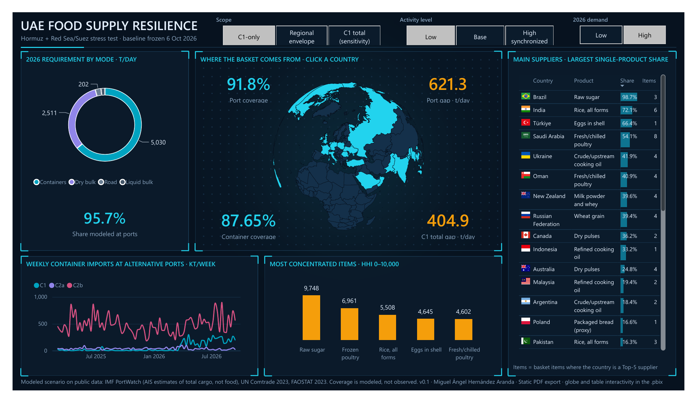

# UAE Food Supply Resilience Stress Test

Open-data stress test of how much of the UAE's import-dependent demand for priority foods could move through alternative routes if the Strait of Hormuz and the Red Sea / Suez route were disrupted at the same time, and where the first binding constraint would appear.

Project 2 of the UAE Data Impact Project 2026.

> **Status: release v0.1.** README revision v0.7.1; analytical model v0.1, frozen on 6 October 2026. The analytical layers, the data model, the Power BI dashboard, the key results and the executive summary are complete and cross-reviewed.

---

## Question

Under simultaneous disruption of Hormuz and the Red Sea / Suez, what share of priority-food demand can alternative routes support, and where does the first binding constraint appear?

The answer is a **bounded scenario**, not an observed national coverage percentage. Public data show total cargo activity at alternative ports and trade by product and origin. They do not show which part of the extra cargo was food. The model therefore reports a physical ceiling and a reference-allocation benchmark side by side, and never calls either one "observed coverage".

## Scope

**Basket.** Nine essential categories, split into the physical forms that move by different modes:

| Category | Physical forms used in the model |
|---|---|
| Wheat | Grain (HS 1001) |
| Rice | All forms (HS 1006) |
| Sugar | Raw, refined |
| Poultry | Frozen, fresh/chilled |
| Eggs | In shell (HS 0407) |
| Dairy | Fresh/yogurt, powder/whey, cheese, butter/ghee |
| Pulses | Dry (HS 0713) |
| Cooking oil | Crude/upstream, refined (frozen H6 whitelist) |
| Bread | Exposure proxy only (HS 190590); no separate gap, to avoid double counting with wheat |

**Demand.** Estimated 2026 resident import-dependent requirement, in tonnes per day. This is a scenario built from 2023 food balances and 2026 population, not observed consumption. Tourism is a separate sensitivity.

**Corridors.**

| Code | Corridor | Ports | Reliability |
|---|---|---|---|
| C1 | UAE east coast, outside Hormuz | Fujairah, Khor Fakkan | B |
| C2a | Oman | Sohar | C (includes Oman's own demand and transshipment) |
| C2b | Oman | Duqm, Salalah | C (long land leg) |
| C3a | Saudi Red Sea | Jeddah, King Abdullah Port | Low (PortWatch anomaly at King Abdullah Port, Aug–Sep 2026) |
| C3b | Regional origin compatible with road | Saudi Arabia, Oman | Not observed: sensitivity only |
| C4 | Air | n/a | Upper-bound sensitivity only |

**Two scopes, always reported in parallel.**

- **C1-only (UAE east-coast ports):** the UAE-attributable floor.
- **Regional envelope (C1 + C2a + C2b):** a regional ceiling. It includes Oman's own demand and needs a cross-border land leg, so it is not guaranteed UAE capacity.

The difference between the two scopes is itself a finding: it measures how much the result depends on access through Oman.

## Data sources

All inputs are public. Nothing in the project depends on replies from institutions.

| Source | Use |
|---|---|
| IMF PortWatch (AIS-based daily port and chokepoint activity) | Observed total-cargo activity by segment at alternative ports; chokepoint transits |
| UN Comtrade, UAE imports 2023 | Physical weights, product mix, supplier shares (HHI, Top 1/3/5) |
| FAOSTAT Food Balances 2023 | Food, production, trade and nutrient supply by commodity group |
| Federal Competitiveness and Statistics Centre (FCSC) and emirate statistics | Population and tourism scaling to 2026 |
| Company and government publications (AD Ports Group, Etihad Rail, Hafeet Rail, Maersk, UNCTAD, among others) | Inland transfer, rail, reefer and rerouting evidence |

The reviewed source register (S01–S89), with links, roles, retrieval status and permitted claim scope, is in [`docs/P2_Source_QC_EN.md`](docs/P2_Source_QC_EN.md).

## Method in brief

1. **Net import requirement (RNI).** For each category: FAOSTAT food minus counted local production, in tonnes per day, scaled to 2026 residents.
   - Animal products made locally from imported feed are reported as input-dependent, not added to the requirement.
   - Cooking-oil production is counted as 0, because local refining uses imported raw material.
2. **Shipment weight.** RNI × `k_ship`, where `k_ship` = Comtrade 2023 physical weight / FAOSTAT 2023 imports. It is not truncated to 1.
3. **Physical split.** Each requirement is divided by its 2023 physical mix before a mode is assigned. Each form is then assigned to a segment:
   - containers;
   - dry bulk;
   - general cargo and RoRo;
   - road (TER);
   - liquid bulk (GL).
4. **Alternative-route activity.** Increment of PortWatch total cargo over the pre-war base (Mar 2025–Feb 2026). A corridor below its base counts as 0. Three activity levels:
   - **Low:** average of the closure period (Mar–Sep 2026);
   - **Base:** last 8 weeks;
   - **High synchronized:** maximum 4-week rolling average of the *contemporaneous* sum of corridors, so peaks from different weeks are never added.
5. **Two coverage measures per segment.**
   - `C_phys = min(1, Δcargo / requirement)` is the physical ceiling. It assumes all incremental cargo could be food.
   - `C_ref = min(1, Δcargo / requirement × 0.196656)` is the reference-allocation benchmark. 19.6656 % is the share of HS 01–24 in the UAE's 2023 non-fuel import weight. It is a sensitivity with confidence C, not an observed segment composition.
   - Gaps follow as `requirement × (1 − C)`, allocated in proportion within each segment.
6. **Outside the port model.**
   - Fresh poultry and fresh dairy (TER) are reported as an unverified regional-route requirement.
   - Crude/upstream cooking oil (GL) is reported as "port coverage not estimable", because PortWatch liquid bulk is dominated by petroleum.
7. **Risk layers.** These are reported next to the gap and never multiplied into tonnes:
   - supplier concentration (HHI, Top 1/3/5);
   - inferred normal maritime route by origin country (confirmed and conditional Red Sea exposure within the Top 5);
   - minimum origin feasibility;
   - kcal and protein.

Container trips are reported only as a truck-equivalent lower bound. 65 t is gross vehicle weight, not payload, so bulk truck trips are reported as NA.

## What this repository does not contain

By design, and following the project protocol:

- no strategic reserve stocks;
- no days-to-depletion;
- no warehouse locations or remaining capacity of specific facilities;
- no facility-level critical routes, replenishment schedules or single points of failure.

All analytical outputs are at corridor level.

## Reproducing the corridor layer

Requirements: Python 3.10+, pandas and openpyxl (`pip install -r requirements.txt`).

```bash
# Rebuild weekly series, corridor summaries and scenario increments from the frozen snapshot
python src/p2_corridors_v0.2.py --data-dir data/snapshot_2026-10-05 --out-dir outputs
```

This script reproduces the frozen snapshot named `snapshot_2026-10-05`. Its download mode (`--fetch`) retrieves live records and keeps the fixed file-name suffix, so it is not a general dated-cut command; it refuses a download when `SHA256SUMS` already exists in the target folder. For reproduction, use the supplied snapshot and check its `SHA256SUMS`.

**Snapshot integrity.** Check the snapshot with `sha256sum -c SHA256SUMS`, run from inside `data/snapshot_2026-10-05/`. Only complete weeks are used; weeks start on Monday.

**Script outputs, in `outputs/`:**

| File | Content |
|---|---|
| `corridor_ports_weekly.csv` | Weekly imports by port and segment |
| `corridor_summary.csv` | Base, closure, change and 4-week maximum by corridor and segment (t/week) |
| `scenario_increments_v0.2.csv` | Low / Base / High-synchronized increments in t/day, for C1-only and the regional envelope; C3a as a separate sensitivity; C1 total (base + increment) sensitivity |
| `chokepoints_weekly.csv`, `chokepoints_summary.csv` | Transits through Hormuz, Bab el-Mandeb, Suez and the Cape |

**Analytical model.** The requirement, exposure and nutrition inputs come from the project workbook. They are frozen in English in `data/model_inputs_2026-10-06/`, and each value carries its source. The script `src/p2_build_model.py` turns them into the tables in `results/` and the Power BI workbook:

```bash
python src/p2_build_model.py --inputs data/model_inputs_2026-10-06 --outputs outputs --results results --xlsx powerbi/P2_PowerBI_model.xlsx
```

Segment requirements, corridor increments and the C1-only Low gaps are the values registered in the workbook, so every figure matches it. `results/model_checks.csv` rebuilds the segment totals from the published rounded inputs. The largest absolute difference is 0.293 t/day (GS, low demand); the largest relative difference is 0.0413 % (GL, low demand). The registered workbook values remain the scenario inputs. In the `C1 total (sensitivity)` rows, the activity column holds total activity (pre-war base + increment), not an increment.

| Table in `results/` | Content |
|---|---|
| `coverage_by_segment.csv` | Requirement, Δcargo, `C_phys`, `C_ref`, gaps, break-even food share and threshold, by scenario, demand and segment |
| `gap_by_subgroup.csv` | Gaps and truck-equivalent lower bounds by commodity subgroup |
| `off_port_requirements.csv` | Road (TER) and liquid-bulk (GL) requirements, with the regional-origin upper bound |
| `food_share_sensitivity.csv` | `C_ref` and gap for food shares from 5 % to 35 % |
| `requirement_by_subgroup.csv`, `categories.csv`, `commodities.csv` | 2026 requirement, `k_ship`, physical mix, segment, priority and confidence |
| `supplier_concentration.csv`, `suppliers_top5.csv` | HHI, Top 1/3/5 and Red Sea exposure within the Top 5 |
| `nutrition.csv` | Energy and protein linked to the import-dependent requirement |
| `corridor_weekly.csv` | Weekly imports by corridor and segment, with the pre-war base |
| `scenarios.csv`, `demand_levels.csv`, `segments.csv`, `corridor_increments.csv` | Scenario dimensions and increments |

## Dashboard

The Power BI report has seven pages in English: Overview, Alternative routes, Gap by commodity, Food-share sensitivity, Suppliers and routes, Nutrition, and Method and limits. Slicers set the scope, activity level, 2026 demand and food share; the defaults are C1-only, Low, high demand and the 19.67 % benchmark.

- `powerbi/P2_FoodResilience.pbix`: the report, ready to open in Power BI Desktop. The dashboard includes the frozen snapshot and can be opened without setting the Excel path. To incorporate new data, it is regenerated with the documented process (below). **Refresh** reprocesses the same embedded snapshot; it does not read new data.
- `powerbi/build_pbip.py`: generates the same report as a Power BI project (TMDL model and PBIR report) from `powerbi/P2_PowerBI_model.xlsx`. By default (`--source embedded`) it embeds each sheet of the workbook in the model as a compressed snapshot; `--source excel --excel-path <path>` connects the model to the workbook file instead. `--base-theme` takes the Fluent 2 base theme that Power BI Desktop writes into every saved project (`Fluent2-CY26SU09.json`); the included `.pbix` contains it (step 2 below).
- `powerbi/make_backgrounds.py`: draws the dark page backgrounds in `powerbi/assets/` from the panel layout in `build_pbip.py`. `powerbi/assets/country_flags.csv` holds the small flag images used in the supplier table.
- `powerbi/export/P2_FoodResilience.pdf`: all seven pages.

**Regenerating the report with new data:**

```bash
# 1. Rebuild the tables in results/ and the model workbook
python src/p2_build_model.py --inputs data/model_inputs_2026-10-06 --outputs outputs --results results --xlsx powerbi/P2_PowerBI_model.xlsx
# 2. Extract the Fluent 2 base theme from the included report
python -c "import zipfile; zipfile.ZipFile('powerbi/P2_FoodResilience.pbix').extract('Report/StaticResources/SharedResources/BaseThemes/Fluent2-CY26SU09.json', 'build')"
# 3. Generate the Power BI project with the new snapshot embedded
python powerbi/build_pbip.py --xlsx powerbi/P2_PowerBI_model.xlsx --base-theme build/Report/StaticResources/SharedResources/BaseThemes/Fluent2-CY26SU09.json --out build/pbip
```

Open `build/pbip/P2_FoodResilience.pbip` in Power BI Desktop, refresh once and save it as a `.pbix`.

The Overview page has scenario buttons, an interactive supplier globe (click a country to filter the supplier table), coverage and gap figures that follow the buttons, the requirement by transport mode, weekly container imports and the most concentrated items. The globe is a Shape Map with an orthographic projection; it loads the world-atlas TopoJSON from jsDelivr, so it needs an internet connection. The chokepoint figures on the Alternative routes page come from `outputs/chokepoints_summary.csv` (cargo ships, closure average vs pre-war base).



## Key results

Frozen analytical baseline of 6 October 2026, cross-reviewed by both assistants. Demand ranges run from low to high 2026 resident demand. All coverage figures are modeled scenarios at corridor level, not observed food coverage.

Public data support a bounded stress-test result, not a single national food-coverage percentage. The two scopes are reported in parallel:

- **C1-only (UAE east-coast ports):** the UAE-attributable floor.
- **Regional envelope (C1 + C2a + C2b):** a conditional ceiling. It includes Oman's own demand and transshipment.

Under the 19.6656 % reference allocation benchmark, C1-only Low covers about **99.3 %–91.8 %** of the modeled port-routed shipment requirement, with a modeled gap of **44.9–621.3 t/day**. The regional Low envelope reaches 100 % if the UAE can access it. The physical ceiling (`C_phys`) is 100 % in both scopes.

The container case is borderline:

- Low activity includes the initial ramp-up.
- The benchmark has confidence C.
- Total C1 activity (base + increment) closes the low-demand gap and reduces the high-demand gap to 404.9 t/day.

The central calculation keeps increments only. Five factors decide how much of this modeled headroom becomes effective supply:

- inland road and rail transfer;
- customs;
- cold-chain execution;
- supplier concentration;
- inferred route exposure.

| KPI | Low demand | High demand | Qualifier |
|---|---:|---:|---|
| Container requirement, t/day | 4,453.521 | 5,029.974 | Physical shipment weight |
| Dry-bulk requirement, t/day | 2,247.644 | 2,510.648 | Physical shipment weight |
| Port-modeled requirement, t/day | 6,701.165 | 7,540.622 | Containers + dry bulk; about 95.7 % of the physical shipment requirement |
| Container `C_ref`, C1-only, Low activity | 98.99 % | 87.65 % | Incremental benchmark |
| Aggregate port `C_ref`, C1-only, Low activity | ~99.3 % | ~91.8 % | Dry bulk stays at 100 % |
| Port gap (`Gap_ref`), C1-only, Low activity, t/day | 44.9 | 621.3 | Central calculation |
| Port `C_ref`, regional envelope, Low activity | 100 % | 100 % | Conditional on UAE access through Oman |
| Physical ceiling `C_phys`, either scope | 100 % | 100 % | Not observed food coverage |
| Port gap with C1 total, Low activity, t/day | 0 | 404.9 | Sensitivity; C1 total = base + increment |
| Road requirement (TER: fresh poultry, fresh dairy), t/day | 176.492 | 202.126 | Road flow not verified; no central credit |
| Liquid-bulk requirement (GL: crude cooking oil), t/day | 123.449 | 137.972 | Port coverage not estimable |
| Energy, million kcal/day | 28,771.7 | 32,254.1 | Analytical basket only |
| Protein, t/day | 763.6 | 860.6 | Analytical basket only |

| Container activity level | C1-only increment, t/day | Regional increment, t/day |
|---|---:|---:|
| Low | 22,418 | 29,109.644 |
| Base | 28,420 | 39,898.797 |
| High synchronized | 34,673.690 | 69,862.190 |

**Container threshold.** At high demand and the default share, closing the container gap needs **25,577.5 t/day** of total incremental cargo. The C1 increment averaged:

- 14,852 t/day in the first eight closure weeks;
- 25,300 t/day in the remaining 21 weeks.

The gap-closing cargo-equivalent is 3,159.5 t/day, or 47.22 % of the C2b Low increment under the same benchmark.

**High activity windows.** C1 High uses weeks starting 6–27 July 2026, and regional High uses 13 July–3 August. At C1 High, the high-demand break-even food share is 14.51 %, and container `C_ref` at a 10 % share is 68.93 %. Segment maxima from different windows are never added as one system peak.

**Supplier concentration.** Measured by 2023 import value, with HHI on a 0–10,000 scale:

| Subgroup | Main supplier | HHI |
|---|---|---:|
| Raw sugar | Brazil 98.7 % | 9,748 |
| Frozen poultry | Brazil 83.2 % | 6,961 |
| Rice | India 72.1 % | 5,508 |
| Eggs | Türkiye 66.4 % | 4,645 |

**Route exposure (inferred).** Within the Top 5 suppliers, confirmed Red Sea exposure is 56.6 % of import value for wheat and 47.7 % for crude/upstream cooking oil.

- "Confirmed" is a route class within an inferred layer, not a tracked shipment.
- Eggs from Türkiye and routes from Canada and the United States stay conditional.
- Top 5 shares do not extend to all imports.

**Road-dependent fresh products.** Fresh poultry and fresh/yogurt dairy are not routed through the port model. Their requirement not sourced from Saudi Arabia or Oman (by 2023 weight within each subgroup) is about 49.8–57.2 t/day. Regional origin does not prove road flow.

**Nutrition.** At high demand:

- wheat gives about 33.4 % of the basket's energy and 39.4 % of its protein;
- cooking oil gives about 27.4 % of energy;
- poultry gives about 27.6 % of protein;
- pulses give 13.76 % of protein, with low confidence.

**Execution evidence.** C1 has official road-and-rail continuity evidence. No cross-border rail credit is given to Oman in this version. Rerouting via the Cape adds a service-specific transit-time reference of roughly 7–14 days, not a universal penalty.

Full wording, definitions and caveats are in the [common narrative](docs/P2_Common_Narrative_EN.md) and the [executive summary](docs/P2_Executive_Summary_EN.md). Source quality control for S01–S89 is in [docs/P2_Source_QC_EN.md](docs/P2_Source_QC_EN.md).

## Limitations

- PortWatch volumes are AIS-based estimates of **total** cargo, not food, and not capacity.
- `C_ref` rests on a broad benchmark (HS 01–24 share of non-fuel imports); the real food share of the incremental cargo is not observed.
- Mode of transport is not observed for UAE 2023 imports. Regional origin (Saudi Arabia, Oman) does not prove road flow.
- Routes are inferred by origin country, not tracked by shipment. Canada and the United States depend on the exit coast or port; eggs from Türkiye depend on the mode. These are reported as conditional.
- King Abdullah Port shows a PortWatch anomaly in Aug–Sep 2026, so C3a is used only as a separate sensitivity.
- Pulses carry low confidence because of a large FAOSTAT residual.

## Repository layout

```
├── README.md
├── LICENSE                       # MIT (code)
├── requirements.txt
├── src/
│   ├── p2_corridors_v0.2.py      # corridor layer and scenario increments
│   └── p2_build_model.py         # analytical model tables and Power BI workbook
├── data/
│   ├── snapshot_2026-10-05/      # frozen IMF PortWatch snapshot + SHA256SUMS
│   └── model_inputs_2026-10-06/  # values frozen from the project workbook, with sources
├── outputs/                      # files produced by the corridor script
├── results/                      # analytical tables (CSV)
├── powerbi/                      # model workbook, DAX measures, report (.pbix), PBIP generator, backgrounds and PDF export
└── docs/                         # executive summary, common narrative, source QC (with its CSVs), model review, dashboard spec and page images
```

## Credits and licence

- **Project lead:** Miguel Ángel Hernández Aranda.
- **Analysis and review:** done with two AI assistants, Claude (Anthropic) and ChatGPT (OpenAI), which cross-reviewed each other's work.
- **Code licence:** MIT (see `LICENSE`), the same licence as Project 1, the [Zero Hormuz Monitor](https://github.com/mhzamx/zero-hormuz-monitor).
- **Map and flags:** world map from [world-atlas](https://github.com/topojson/world-atlas) (ISC licence; Natural Earth data, public domain); flags from [flag-icons](https://github.com/lipis/flag-icons) (MIT).
- **Data:** the MIT licence covers the code only; it does not relicense any source data. Each source keeps its own terms (checked on 9 October 2026):
  - **IMF PortWatch** (raw snapshot in `data/snapshot_2026-10-05/`, derived series in `outputs/`): the [IMF terms for statistical data](https://www.imf.org/en/about/copyright-and-terms) allow copying, publishing and distributing the data with attribution. Source: International Monetary Fund, PortWatch, https://portwatch.imf.org. The corridor outputs are transformations of the snapshot, described in this README. Commercial reuse needs the IMF's permission.
  - **FAOSTAT** (values in `data/model_inputs_2026-10-06/` and `results/`): CC BY 4.0, used under the [FAO Statistical Database Terms of Use](https://www.fao.org/contact-us/terms/db-terms-of-use), which apply alongside the licence. Citations in the format FAO requests (verified on 11 October 2026):
    - FAO. 2025. FAOSTAT: Food Balances (2010-). Accessed on 5 October 2026. https://www.fao.org/faostat/en/#data/FBS. Licence: CC-BY-4.0.
    - FAO. 2025. FAOSTAT: Crops and livestock products. Accessed on 5 October 2026. https://www.fao.org/faostat/en/#data/QCL. Licence: CC-BY-4.0.

    2025 is the year of FAO's last data update for both datasets (data revision dates in the FAO Data Catalog: 16 October 2025 for [Food Balances](https://data.fao.org/catalog/dataset/2f264bb6-1238-459a-bf8b-0e2d0a16804a) and 15 December 2025 for [crop production](https://data.fao.org/catalog/iso/d24a448b-3b62-4c09-8c1d-4a39bb599876)); the data analysed refer to 2023. The values were extracted through FAO's official BigQuery service (sources S56, S72, S73 and S84 in `docs/P2_Source_QC_EN.md`).
  - **UN Comtrade** (supplier shares, concentration indices and route exposure in `data/model_inputs_2026-10-06/` and `results/`): derived indicators, not as-is extracts; UN Comtrade's [use and re-dissemination policy](https://uncomtrade.org/docs/faqs-on-use-and-re-dissemination/) treats these as transformed data.
